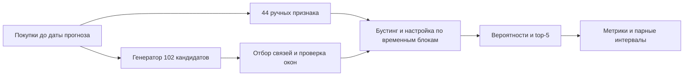

# Автоматизация признаков для рекомендаций финансовых активов

Учебное ML-исследование на FAR-Trans. На начало месяца модель оценивает записанную покупку актива и выбирает пять активов для клиента. Выполнены оба этапа задания: **ручные признаки и настроенный градиентный бустинг**, затем **автоматическая генерация, отбор признаков и эксперименты**.

## Как читать работу

1. **[Полный отчёт с формулами и расчётами](REPORT.md)** — задача, данные, временной протокол, модели, реальный пример top-5, результаты и статистическая неопределённость.
2. **[Каталог признаков](docs/FEATURES.md)** — все 44 ручные фичи, грамматика 102 кандидатов, выбранные 28 и шесть добавлений к ручной базе.
3. **[Рекомендации](docs/RECOMMENDATIONS.md)** — выбор текущего решения, недостатки и приоритетный план следующих экспериментов.
4. **[Воспроизведение](docs/REPRODUCIBILITY.md)** — проверка готовых моделей и полный запуск с указанными версиями.

Для первого знакомства: [краткое объяснение работы с нуля](reports/feature_engineering_automation/research_summary_ru.md).

## Что получилось

Финальная оценка: июль–октябрь 2022, 500 клиентов, 50 активов. Recall@5 — средняя доля купленных внутри каталога активов, найденных в пяти рекомендациях, по клиент-месяцам с покупками.

| Метод | Признаков | Recall@5 |
|---|---:|---:|
| Пять счётчиков с новым подбором | 5 | 59,18% |
| **Ручной бустинг** | **44** | **65,53%** |
| Все исходные автоматические | 102 | 63,68% |
| Автоматический отбор | 28 | 64,32% |
| Ручные + автоматические | 50 | 64,39% |
| Повторные покупки + популярность | — | 61,71% |

Ручная инженерия дала наблюдаемый прирост **+6,35 п.п.** относительно пяти счётчиков с одинаковыми выбранными параметрами. Добавление автоматических признаков к ручным: **−1,14 п.п.**, 95% клиентский интервал **[−2,92; +0,42] п.п.** Преимущество автоматизации по основной метрике не подтверждено; эквивалентность тоже не установлена.

**Ограничение доказательств:** итоговый период уже раскрывался при предшествующем аудите. Поэтому новая оценка исследовательская и требует независимого подтверждения. Покупки не доказывают доходность или пригодность актива клиенту.

## Схема решения



## Выполненные notebooks и доказательства

- [01 — ручной бустинг](reports/feature_engineering_automation/01_manual_baseline.ipynb).
- [02 — автоматизация](reports/feature_engineering_automation/02_feature_automation.ipynb).
- [03 — эксперименты](reports/feature_engineering_automation/03_experiments.ipynb).
- [Результаты](reports/feature_engineering_automation/results/evaluation.json), [протокол](reports/feature_engineering_automation/results/protocol.json), [журнал](reports/feature_engineering_automation/results/trials.jsonl).
- [Расчёты примеров и знаменателей](docs/evidence/submission_calculations.json), [107 уникальных определений признаков в CSV](docs/features.csv).
- [Подтверждения проверок](reports/feature_engineering_automation/results/verification.json): восемь тестов, независимые метрики, воспроизведение вероятностей пяти моделей и проверка временных фильтров.

Обучение выполнено отдельными фазами CLI. Notebooks содержат выполненные ячейки чтения журналов и проверки результатов; для полного повторного обучения используются команды из инструкции либо RUN_TRAINING с новой папкой результатов.

## Структура

```text
README.md                            — входная страница
REPORT.md                            — полный отчёт
docs/FEATURES.md                      — признаки и формулы
docs/RECOMMENDATIONS.md               — рекомендации и ограничения
docs/REPRODUCIBILITY.md               — команды воспроизведения
docs/evidence/                       — расчёты и проверка комплекта
scripts/build_submission.py          — сборка документов без обучения
research/feature_automation/          — код пайплайна и тесты
reports/feature_engineering_automation/ — notebooks, модели, предсказания и журналы
reports/finance_ml_audit/             — предшествующий аудит и снимки входов
```

Основные файлы для сдачи — REPORT.md, каталог признаков, рекомендации и три notebooks. Предшествующий аудит сохранён для происхождения работы; его числа относятся к прежним моделям.

## Данные и источники

FAR-Trans: Javier Sanz-Cruzado, Nikolaos Droukas, Richard McCreadie, 2024. [Данные University of Glasgow, CC BY 4.0](https://researchdata.gla.ac.uk/1658/) · [Публикация](https://arxiv.org/html/2407.08692v1).

Публичный архив сохранён и проверяется по SHA-256. Лицензия CC BY 4.0 относится к данным FAR-Trans; она не назначает автоматически лицензию остальному коду. Научные источники и ограничения перечислены в полном отчёте.
